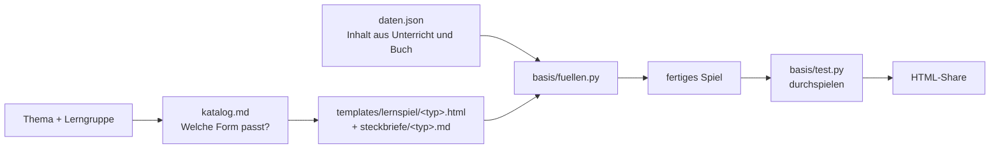

# Lernspiele

Spielformen, Vorlagen zum Wiederverwenden und fertige eigene Spiele. Jedes Spiel ist eine einzige HTML-Datei, ohne
Internet, ohne Anmeldung, ohne Daten von Schülerinnen und Schülern. So läuft es in HTML-Share, am iPad und am Handy.
Regeln: [ADR-0033](../adr/0033-lernspiele.md) (welche Spielmechaniken erlaubt sind) und Profil
[Lernspiel](../profiles/lernspiel.md). Design: v3 „Signal“ ([ADR-0031](../adr/0031-design-system-v3-signal.md)).



## Aufbau

| Ort | Inhalt |
|---|---|
| `../templates/lernspiel/<typ>.html` | die Vorlagen (gebaut, nicht von Hand ändern) |
| `katalog.md` | alle Spielformen, Auswahlhilfe „Inhalt → Form“, Stand gebaut/geplant |
| `steckbriefe/<typ>.md` | je Vorlage: wofür, Daten, Grenzen |
| `basis/` | `basis.py` (Aussehen, Antwortprüfung), `bauen.py` (baut alle Vorlagen), `fuellen.py`, `test.py` |
| `beispiele/` | Daten-Dateien als Muster für `fuellen.py` |
| `spiele/<fach>/` | fertige eigene Spiele, die sich bewährt haben |
| `ideen/` | gesehene Spiele und Anregungen, nur beschrieben |

## Benutzen

Ohne Werkzeuge: Vorlage öffnen, Abschnitt `ANPASSEN` ändern (oder von einer KI ändern lassen, der Prompt steht oben
in jeder Datei), unter eigenem Namen speichern.

Mit den Werkzeugen (Python 3, für `test.py` zusätzlich Playwright mit Chromium), aus dem Repo-Ordner:

```bash
python3 -I lernspiele/basis/fuellen.py lernspiele/beispiele/escape-prozent.json /pfad/escape-prozent-7.html  # füllen und prüfen
python3 -I lernspiele/basis/test.py /pfad/escape-prozent-7.html                                             # durchspielen
python3 -I lernspiele/basis/bauen.py && python3 -I lernspiele/basis/test.py                                 # nach Änderung an basis/
```

Die Werkzeuge sind optional (ADR-0033, Abschnitt 5): Sie bauen nichts, was man zum Spielen braucht.

## Aufgaben-Format

```js
{ frage: 'Wie viel sind 3/4 von 20?', antwort: 15, tipp: '20 : 4 = 5, dann mal 3.' }            // Eingabe
{ frage: '1/2 + 1/4 = ?', antwort: '3/4', optionen: ['3/4', '2/6', '1/6', '2/4'] }              // Antippen
{ frage: 'Wie viel Prozent sind 7/10?', antwort: ['70 %', '70%', '70'] }                        // mehrere richtig
```

Die Prüfung ist tolerant: Groß/klein, Leerzeichen, Komma oder Punkt, Zahlen als Zahl.

## Neue Spielform

1. In `katalog.md` als „geplant“ eintragen, Herkunft in `ideen/`.
2. Prüfen, ob die Mechanik in ADR-0033 Abschnitt 1 erlaubt ist; sonst erst die ADR ändern.
3. In `basis/bauen.py` einen Eintrag in `SPIELE` (CSS, Body, `ANPASSEN`, Spiel-Skript). Konstanten im Abschnitt
   `ANPASSEN` je Zeile `const NAME = …;`, Listen als `const NAME = [` … `];` – nur so kann `fuellen.py` sie ersetzen.
4. In `basis/test.py` unter `spiele()` das Durchspielen ergänzen.
5. `steckbriefe/<typ>.md` schreiben, Katalog auf „gebaut“, bauen, testen, committen.

## Regeln

- Keine Namen, Fotos oder Daten von Schülerinnen und Schülern, auch nicht als Beispiel; keine Namenseingabe im Spiel.
- Kein fremder Code und keine Figuren, Marken oder Welten aus kommerziellen Spielen.
- Inhalte nur aus Unterricht, Lehrplan und Buch der Lerngruppe oder selbst gerechnet; Verlagstexte nicht abschreiben.
- Nichts nachladen (keine Schriften, Bilder, Skripte von außen).
